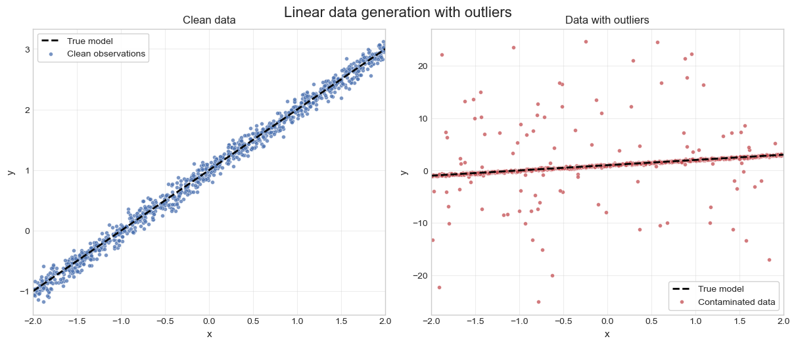
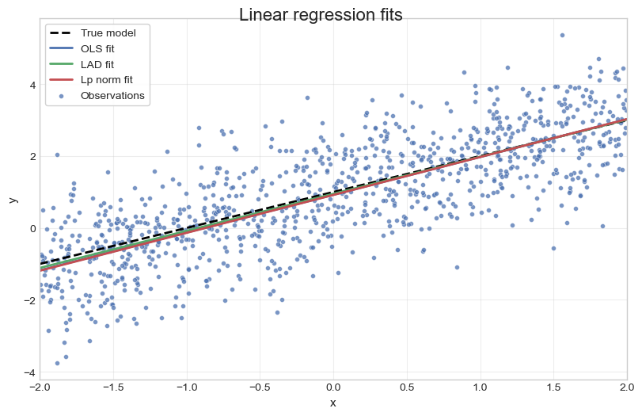
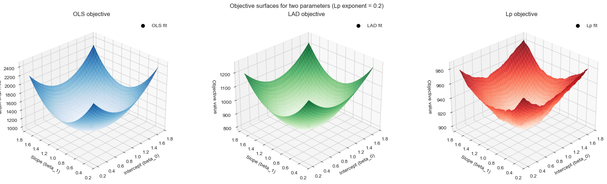
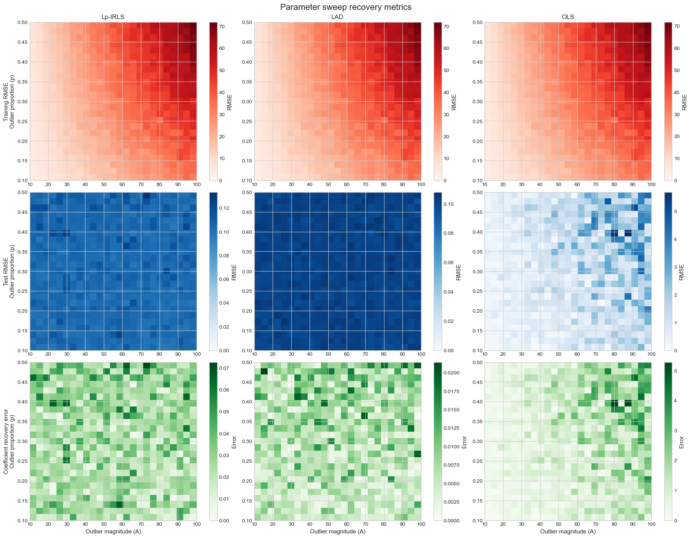
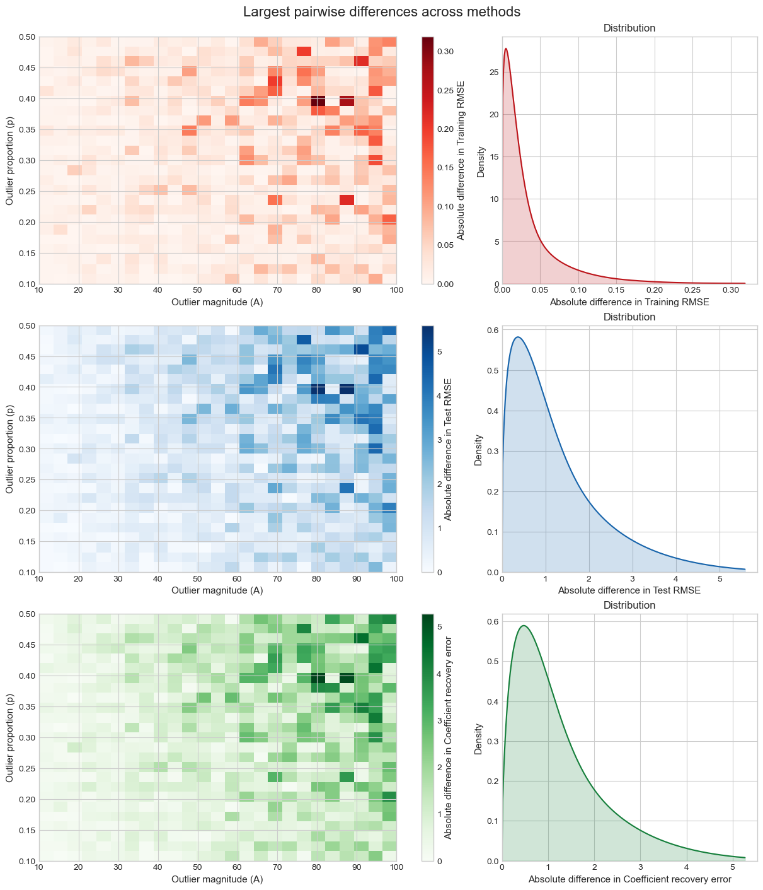
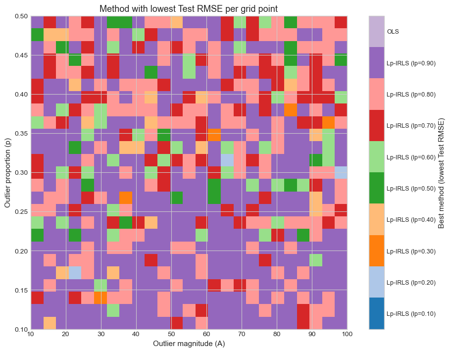
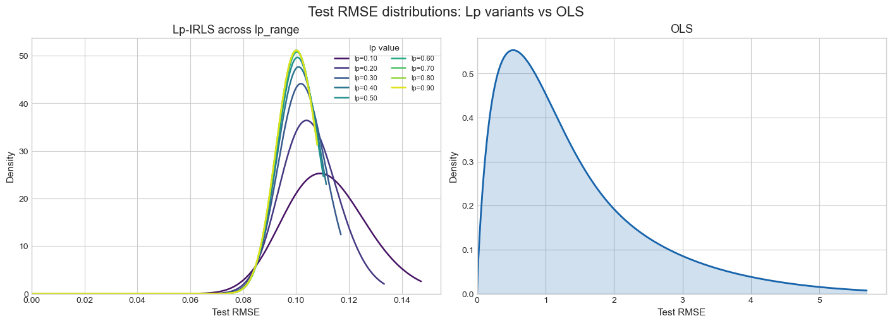
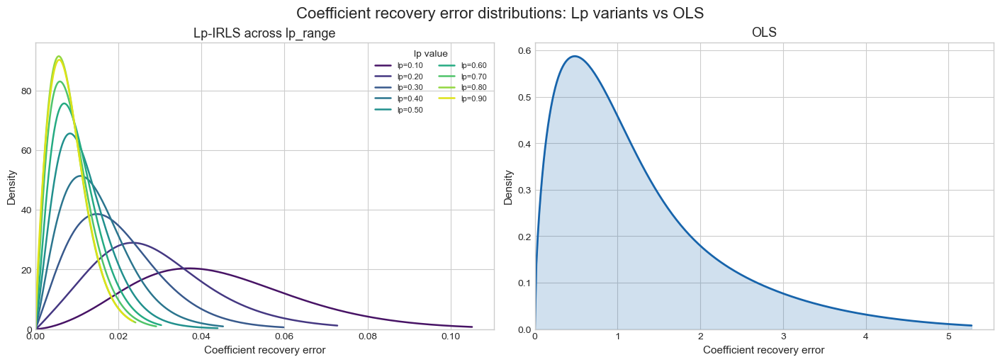
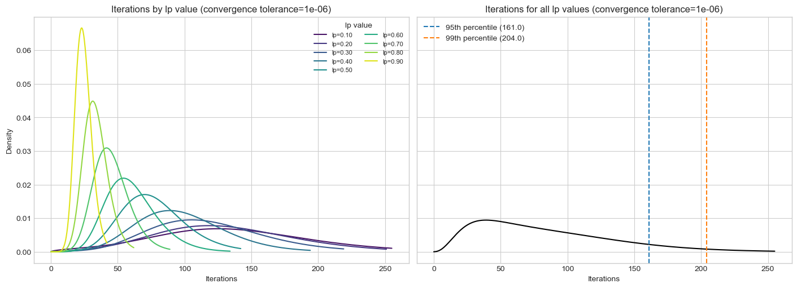
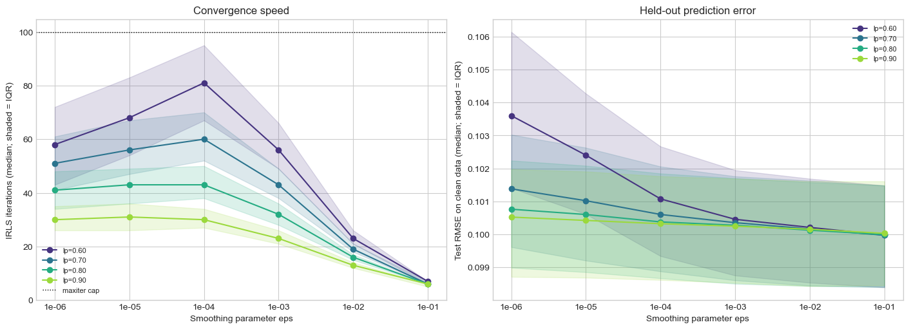

# Documentation

## Introduction

The question behind this project is whether a non-convex $L_p$ regression objective, with $0<p<1$, can improve the recovery of a linear relationship when some of the training responses are outliers. To see how it behaves, this method is compared with ordinary least squares (OLS) and least absolute deviations (LAD) on synthetic data where the true relationship is known. The models are tested on clean data (with noise but without outliers), as the outlier rejection of this method is the object of study.

Initially, the experiments use one feature and one seeded dataset for each contamination setting. This is enough to see how the methods respond as the outliers become more frequent or more extreme, but it does not tell us how they would perform on average over many different samples.

## Justification

Ordinary Least Squares (OLS) regression works by finding the coefficients that minimize quadratic error among the data. Thus, let $y\in \mathbb{R}^n$ be a vector of outcomes given by a $X\in\mathbb{R}^{n\times p}$ design matrix, the regression coefficients will be

$$
\hat{\beta}_{\mathrm{OLS}}=\argmin_{\beta\in\mathbb{R}^p}\|y-X\beta^T\|_2^2
$$

where $\|\cdot\|_2$ denotes the euclidean norm. However, if the data contains outliers, they will have a big impact on the function, heavily skewning the result. Thus, other norms can be explored to try and reduce the impact big residuals will have.

Least Absolute Deviations (LAD), also called $L_1$ regression, uses the sum of absolute residuals instead. Let $y\in\mathbb{R}^n$ be the responses, and $X\in\mathbb{R}^{n\times d}$ the design matrix. For $\beta=(\beta_0,\beta_1,\ldots,\beta_d)^T$, the residual for observation $i$ is $r_i=(X\beta-y)_i$. LAD is formulated as

$$
\hat{\beta}_{\mathrm{LAD}}
=\argmin_{\beta\in\mathbb{R}^{d+1}}\sum_{i=1}^{n}|r_i|.
$$

More generally, $L_p$ regression replaces absolute residuals with their $p$th powers. For $0<p<1$, the theoretical objective is

$$
\hat{\beta}_{p}
=\argmin_{\beta\in\mathbb{R}^{d+1}}\sum_{i=1}^{n}|r_i|^p.
$$

Unlike squared or absolute error, $|r_i|^p$ grows sublinearly for large residuals, so an outlying response contributes less relative to a well-fitted observation. The price is that this objective is non-convex: a theoretical solution would minimize the stated objective over the coefficients, but finding its global minimum is generally harder and optimization can be sensitive to initialization. This formulation describes the target criterion; the numerical method used to approximate a fit is described below.

## Data generation

A 2 parameter linear model can be formulated as

$$
y_i = \beta_0 + x_i\beta_1 + \eta_i,

$$

where feature values are sampled uniformly over an interval and $\eta_i$ is Gaussian noise. For the first example, the parameters used are $n=1000$, $\beta=(1,1)$, $x\in[-2,2]$, and the noise standard deviation to $0.1$. Starting from a known line makes it straightforward to check whether the fitted models recover the coefficients we put in. This clean data generator will be used for model testing

The second version is constructed using the test data generator. It works in the same way as the clean data, but selects each observation with probability $c$ and adds a Gaussian perturbation of standard deviation $A$ to its response. These are vertical outliers: only $y_i$ changes, not $x_i$. With $c=0.1$ and $A=10$, the contrast is easy to see in the plot. The generating line stays the same; only some observations are pushed away from it.

One detail worth keeping straight is that the noise and smoothing are two different variables that can be denoted by $\epsilon$. The generator uses `epsilon` for the Gaussian noise standard deviation, while `eps` in the fitting code controls smoothing of the $L_p$ objective.

## Comparing regression models

With the data in place, the next question is how the choice of loss changes the fitted line. OLS minimizes the sum of squared residuals, $\sum_i r_i^2$, while LAD minimizes the sum of absolute residuals, $\sum_i |r_i|$. The third fit minimizes a smoothed $L_p$ objective

$$
F_{p,\epsilon}(\beta) = \sum_i (r_i^2+\epsilon^2)^{p/2}, \qquad r_i = \beta_0+x_i\beta_1-y_i,
$$

with $0<p<1$ and positive smoothing parameter $\epsilon$. This smoothing parameter is used to avoid infinite weights for points that lie on the fitted line.

For the $L_p$ fit, the iteratively reweighted least squares (IRLS) method is used. It is used because the optimization problem does not have a close form solution. The idea is to give each observation a weight based on its current residual:

$$
w_i^{(k)} = \left((r_i^{(k)})^2+\epsilon^2\right)^{(p-2)/2}
$$

The method then solves a weighted least-squares problem and updates the residuals before repeating. By default, it starts at the OLS fit. It stops when the relative change in the smoothed objective is small enough, or when the iteration limit is reached.

Firstly, the three models are fitted on clean data as a sanity check ($n=1000$, $\beta=(1,1)$, and noise standard deviation $1$), using $p=0.2$ and $\epsilon=10^{-3}$ for the $L_p$ model. The three fitted lines are close to one another here, which is to be expected when there are no outliers for the robust losses to handle. To get a better sense of what the optimizer is dealing with, the objecive functions are also plotted over a grid of intercept and slope values. The OLS and LAD surfaces have broad bowl-like shapes, while the $L_p$ surface is less regular. Both the value por $p$ and the smoothing will affect the regularness of the surface. These plots help visualize the difference, but they are only a snapshot for this particular dataset; they do not prove convergence or non-convexity in general.

## Effect of outlier proportion and magnitude

The clean-data comparison provides a useful starting point, but does not show how the models respond to outliers. To examine this, the contamination level is increased, and each model is fitted to the contaminated training sample before its predictions are evaluated on a clean sample from the same model. Training RMSE, clean-test RMSE, coefficient recovery error $\|\hat\beta-\beta\|_2$, and fit time are recorded. Clean-test RMSE is particularly informative: a model may fit the outlying training responses closely while still failing to recover the underlying relationship.

For this sweep, $p=0.2$ and $\epsilon=10^{-3}$ are fixed, and IRLS is allowed up to 500 iterations. The contamination proportion is varied over 25 values from 0.1 to 0.5, and the outlier magnitude over 25 values from 10 to 100, giving 625 conditions. A separately seeded training and test sample is generated for each condition. All three estimators are fitted to the same data within a condition, allowing them to be compared directly at each point in the grid.

The heatmaps show how the errors vary across the grid. The largest pairwise difference between methods is also examined at each condition, and `gamma_kde` is used to summarize the distribution of these differences. The methods are most distinct under the more severe contamination settings. However, since each point represents a single sample, the plots show where the methods differ in this run, not how consistently they differ across repeated experiments.

The timing results indicate the computational cost of this sweep. OLS took 0.032 s in total (0.000051 s mean and 0.000041 s median per fit), $L_p$-IRLS took 7.038 s (0.011261 s mean and 0.011075 s median), and LAD took 58.962 s (0.094339 s mean and 0.097893 s median). In this run, OLS was the fastest and LAD the slowest. Since timings depend on the machine and implementation, they are best interpreted as a comparison within this experiment rather than as universal benchmarks.

The distributions are shown using a gamma-kernel density estimate (KDE) rather than histograms, avoiding sensitivity to the choice of bin size. A gamma KDE is used instead of a Gaussian KDE because the pairwise difference magnitudes are non-negative.

However, some key findings can be extracted off this data. Firstly, train-RMSE is not significantly different, as all methods are pretty efficient at regression. Also, both LAD and Lp show consistently better performance at high outlier magnitudes, as it can be seen in the axes of the test-RMSE plot. Finally, the lp iterative method is significatively faster than LAD ($\approx8.4\times$ faster). Therefore, to speed up computation, LAD will no longer be used, as a similar performance is obtanied but requiring much higher computational cost.

## Effect of the $L_p$ exponent

The next step is to examine how the exponent affects the results. The comparison is repeated over the same contamination grid, using nine values from $p=0.1$ to $p=0.9$. At each grid point, the clean-test RMSE of each $L_p$ fit is compared with that of OLS. One plot shows which model achieves the lowest test error in each condition, while another summarizes the distribution of test errors across the grid.

These results provide an initial indication of how the exponents perform under different contamination levels. The best-performing method varies across grid points, so the plots do not establish one exponent as universally best. Each point still represents only one generated sample; repeated seeds would be needed to make a more reliable choice. However, generally higher values for exponents provide better results, suggesting that too low of an exponent makes the problem too non-convex, making the solver get stuck on a local minimum rather than the global one.

It can also be noted how the peaks of the gamma KDEs converge to 0.1, which is the gaussian noise standard deviation of the test data. This suggests that average case test RMSE will be bounded by the noise of the test data. If coefficient recovery is represented instead, the results are the following.

## Smoothing and IRLS convergence

Smoothing, $\epsilon$, is another parameter that can affect the fit. Its effect is examined through both clean-test RMSE and the number of IRLS updates. The first run compares exponents from 0.1 to 0.9 at $\epsilon=10^{-3}$, with a tolerance of $10^{-6}$ and a limit of 500 iterations. The second run focuses on $p=0.6, 0.7, 0.8,$ and $0.9$, while $\epsilon$ is varied from $10^{-1}$ to $10^{-6}$. The plots summarize the medians and interquartile ranges across the contamination conditions.

The iteration counts show the clearest pattern. In this sweep, they peak around $\epsilon=10^{-4}$ and decrease toward both ends of the range, particularly for the lower exponents. The median clean-test RMSE is lowest at $\epsilon=10^{-1}$, where the solver also uses the fewest updates. This suggests that, for these clean test samples, stronger smoothing can make optimization easier while still recovering a useful general fit. At the other end, small smoothing values are associated with higher test error, most notably for $p=0.6$. Although iteration counts also fall between the peak and $\epsilon=10^{-6}$, this faster stopping does not correspond to better prediction. It may reflect difficulty navigating the less-smooth, non-convex objective rather than finding a better solution; the plots alone do not establish why the runs stop.

These patterns are observations from the current plots rather than firm conclusions, since each condition still uses a single generated dataset. In particular, iteration count alone cannot show whether the optimizer converged to a good solution.

Iteration counts also need to be interpreted with care. A run that reaches the iteration limit has not necessarily met the convergence tolerance. On the other hand, stopping quickly does not by itself indicate good predictive performance; clean-test error must also be considered.

Here it can also be noted how the average behavior is bounded by the noise standard deviation, as all test RMSEs converge to 0.1, suggesting near perfect coefficient recovery.

## Initial findings

Taken together, these experiments provide an initial comparison of OLS, LAD, and smoothed $L_p$-IRLS when some responses are contaminated. Prediction error, coefficient recovery, and computation are considered separately because each describes a different aspect of the fit. In the timing run, OLS was fastest, LAD was slowest, and $L_p$-IRLS fell between them.

The current results are not sufficient to conclude that $L_p$-IRLS generally outperforms OLS or LAD. In order to achieve so, some optimal values for the parameters will be found, in order to run Monte-Carlo simulations on the models.
