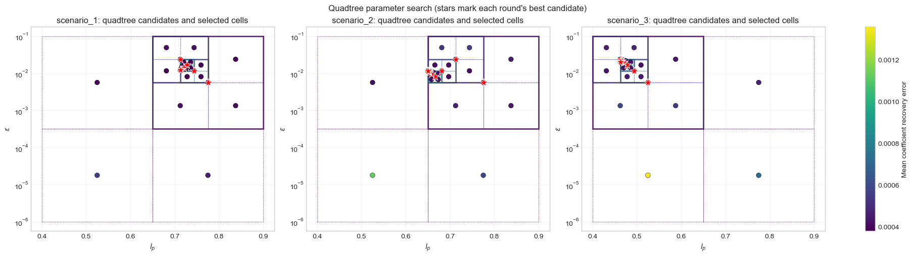
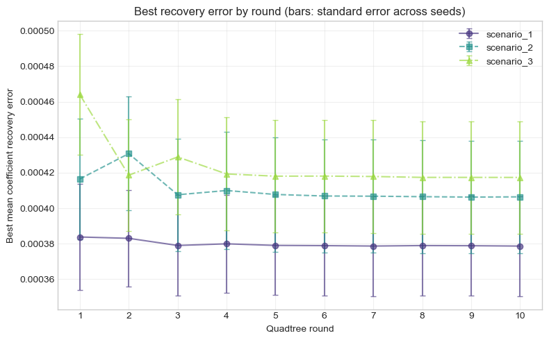
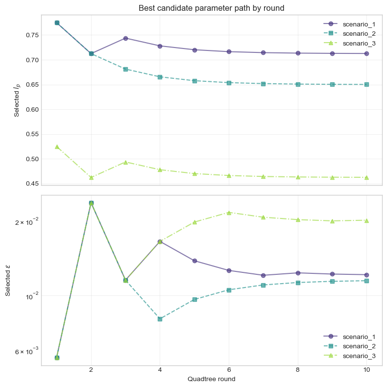
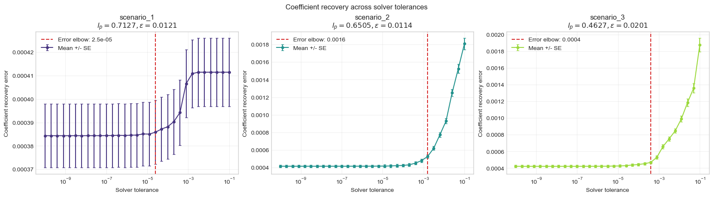
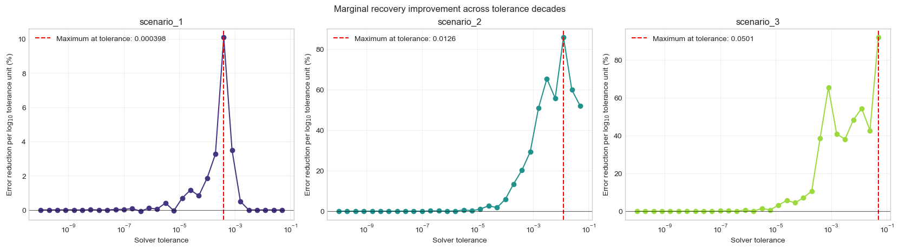
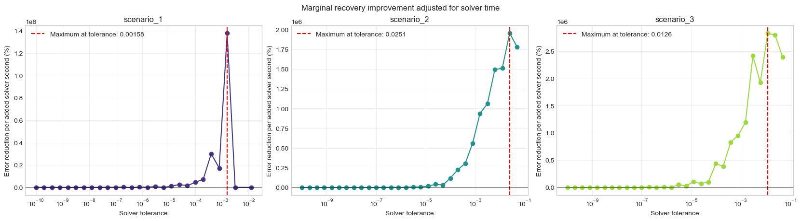
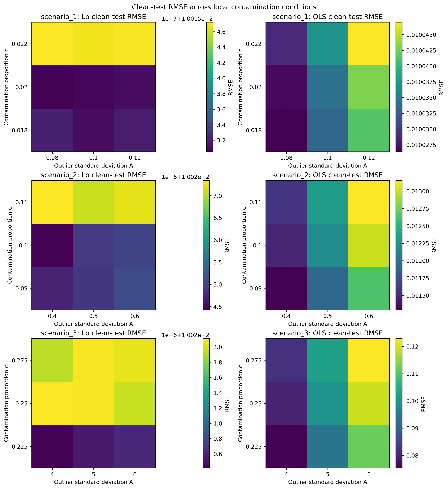
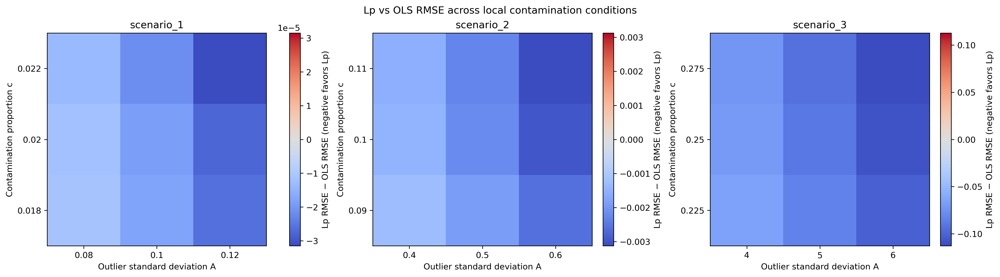
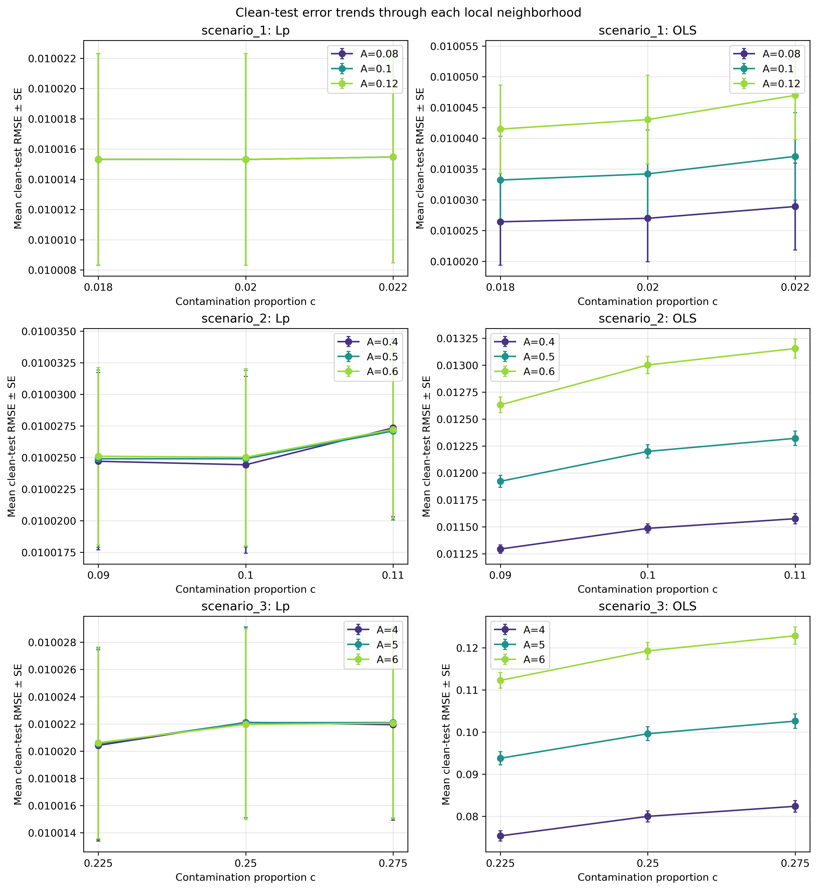
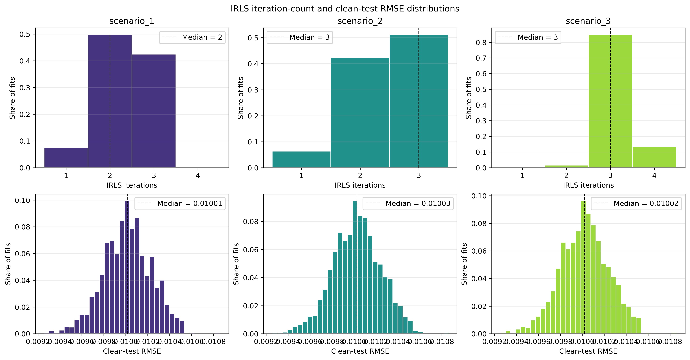

# Documentation

## Introduction

The question behind this project is whether a non-convex $L_p$ regression objective, with $0<p<1$, can improve the recovery of a linear relationship when some of the training responses are outliers. To see how it behaves, this method is compared with ordinary least squares (OLS) and least absolute deviations (LAD) on synthetic data where the true relationship is known. The models are tested on clean data (with noise but without outliers), as the outlier rejection of this method is the object of study.

Initially, the experiments use one feature and one seeded dataset for each contamination setting. This is enough to see how the methods respond as the outliers become more frequent or more extreme, but it does not tell us how they would perform on average over many different samples.

## Justification

Ordinary Least Squares (OLS) regression works by finding the coefficients that minimize quadratic error among the data. Thus, let $y\in \mathbb{R}^n$ be a vector of outcomes given by a $X\in\mathbb{R}^{n\times p}$ design matrix, the regression coefficients will be

$$
\hat{\beta}_{\mathrm{OLS}}=\argmin_{\beta\in\mathbb{R}^p}\|y-X\beta^T\|_2^2
$$

where $\|\cdot\|_2$ denotes the euclidean norm. However, if the data contains outliers, they will have a big impact on the function, heavily skewning the result. Thus, other norms can be explored to try and reduce the impact big residuals will have.

Least Absolute Deviations (LAD), also called $L_1$ regression, uses the sum of absolute residuals instead. Let $y\in\mathbb{R}^n$ be the responses, and $X\in\mathbb{R}^{n\times d}$ the design matrix. For $\beta=(\beta_0,\beta_1,\ldots,\beta_d)^T$, the residual for observation $i$ is $r_i=(X\beta-y)_i$. LAD is formulated as

$$
\hat{\beta}_{\mathrm{LAD}}
=\argmin_{\beta\in\mathbb{R}^{d+1}}\sum_{i=1}^{n}|r_i|.
$$

More generally, $L_p$ regression replaces absolute residuals with their $p$th powers. For $0<p<1$, the theoretical objective is

$$
\hat{\beta}_{p}
=\argmin_{\beta\in\mathbb{R}^{d+1}}\sum_{i=1}^{n}|r_i|^p.
$$

Unlike squared or absolute error, $|r_i|^p$ grows sublinearly for large residuals, so an outlying response contributes less relative to a well-fitted observation. The price is that this objective is non-convex: a theoretical solution would minimize the stated objective over the coefficients, but finding its global minimum is generally harder and optimization can be sensitive to initialization. This formulation describes the target criterion; the numerical method used to approximate a fit is described below.

## Data generation

A 2 parameter linear model can be formulated as

$$
y_i = \beta_0 + x_i\beta_1 + \eta_i,

$$

where feature values are sampled uniformly over an interval and $\eta_i$ is Gaussian noise. For the first example, the parameters used are $n=1000$, $\beta=(1,1)$, $x\in[-2,2]$, and the noise standard deviation to $0.1$. Starting from a known line makes it straightforward to check whether the fitted models recover the coefficients we put in. This clean data generator will be used for model testing

The second version is constructed using the test data generator. It works in the same way as the clean data, but selects each observation with probability $c$ and adds a Gaussian perturbation of standard deviation $A$ to its response. These are vertical outliers: only $y_i$ changes, not $x_i$. With $c=0.1$ and $A=10$, the contrast is easy to see in the plot. The generating line stays the same; only some observations are pushed away from it.

One detail worth keeping straight is that the noise and smoothing are two different variables that can be denoted by $\epsilon$. The generator uses `epsilon` for the Gaussian noise standard deviation, while `eps` in the fitting code controls smoothing of the $L_p$ objective.

## Comparing regression models

With the data in place, the next question is how the choice of loss changes the fitted line. OLS minimizes the sum of squared residuals, $\sum_i r_i^2$, while LAD minimizes the sum of absolute residuals, $\sum_i |r_i|$. The third fit minimizes a smoothed $L_p$ objective

$$
F_{p,\epsilon}(\beta) = \sum_i (r_i^2+\epsilon^2)^{p/2}, \qquad r_i = \beta_0+x_i\beta_1-y_i,
$$

with $0<p<1$ and positive smoothing parameter $\epsilon$. This smoothing parameter is used to avoid infinite weights for points that lie on the fitted line.

For the $L_p$ fit, the iteratively reweighted least squares (IRLS) method is used. It is used because the optimization problem does not have a close form solution. The idea is to give each observation a weight based on its current residual:

$$
w_i^{(k)} = \left((r_i^{(k)})^2+\epsilon^2\right)^{(p-2)/2}
$$

The method then solves a weighted least-squares problem and updates the residuals before repeating. By default, it starts at the OLS fit. It stops when the relative change in the smoothed objective is small enough, or when the iteration limit is reached.

Firstly, the three models are fitted on clean data as a sanity check ($n=1000$, $\beta=(1,1)$, and noise standard deviation $1$), using $p=0.2$ and $\epsilon=10^{-3}$ for the $L_p$ model. The three fitted lines are close to one another here, which is to be expected when there are no outliers for the robust losses to handle. To get a better sense of what the optimizer is dealing with, the objecive functions are also plotted over a grid of intercept and slope values. The OLS and LAD surfaces have broad bowl-like shapes, while the $L_p$ surface is less regular. Both the value por $p$ and the smoothing will affect the regularness of the surface. These plots help visualize the difference, but they are only a snapshot for this particular dataset; they do not prove convergence or non-convexity in general.

## Effect of outlier proportion and magnitude

The clean-data comparison provides a useful starting point, but does not show how the models respond to outliers. To examine this, the contamination level is increased, and each model is fitted to the contaminated training sample before its predictions are evaluated on a clean sample from the same model. Training RMSE, clean-test RMSE, coefficient recovery error $\|\hat\beta-\beta\|_2$, and fit time are recorded. Clean-test RMSE is particularly informative: a model may fit the outlying training responses closely while still failing to recover the underlying relationship.

For this sweep, $p=0.2$ and $\epsilon=10^{-3}$ are fixed, and IRLS is allowed up to 500 iterations. The contamination proportion is varied over 25 values from 0.1 to 0.5, and the outlier magnitude over 25 values from 10 to 100, giving 625 conditions. A separately seeded training and test sample is generated for each condition. All three estimators are fitted to the same data within a condition, allowing them to be compared directly at each point in the grid.

The heatmaps show how the errors vary across the grid. The largest pairwise difference between methods is also examined at each condition, and `gamma_kde` is used to summarize the distribution of these differences. The methods are most distinct under the more severe contamination settings. However, since each point represents a single sample, the plots show where the methods differ in this run, not how consistently they differ across repeated experiments.

The timing results indicate the computational cost of this sweep. OLS took 0.032 s in total (0.000051 s mean and 0.000041 s median per fit), $L_p$-IRLS took 7.038 s (0.011261 s mean and 0.011075 s median), and LAD took 58.962 s (0.094339 s mean and 0.097893 s median). In this run, OLS was the fastest and LAD the slowest. Since timings depend on the machine and implementation, they are best interpreted as a comparison within this experiment rather than as universal benchmarks.

The distributions are shown using a gamma-kernel density estimate (KDE) rather than histograms, avoiding sensitivity to the choice of bin size. A gamma KDE is used instead of a Gaussian KDE because the pairwise difference magnitudes are non-negative.

However, some key findings can be extracted off this data. Firstly, train-RMSE is not significantly different, as all methods are pretty efficient at regression. Also, both LAD and Lp show consistently better performance at high outlier magnitudes, as it can be seen in the axes of the test-RMSE plot. Finally, the lp iterative method is significatively faster than LAD ($\approx8.4\times$ faster). Therefore, to speed up computation, LAD will no longer be used, as a similar performance is obtanied but requiring much higher computational cost.

## Effect of the $L_p$ exponent

The next step is to examine how the exponent affects the results. The comparison is repeated over the same contamination grid, using nine values from $p=0.1$ to $p=0.9$. At each grid point, the clean-test RMSE of each $L_p$ fit is compared with that of OLS. One plot shows which model achieves the lowest test error in each condition, while another summarizes the distribution of test errors across the grid.

These results provide an initial indication of how the exponents perform under different contamination levels. The best-performing method varies across grid points, so the plots do not establish one exponent as universally best. Each point still represents only one generated sample; repeated seeds would be needed to make a more reliable choice. However, generally higher values for exponents provide better results, suggesting that too low of an exponent makes the problem too non-convex, making the solver get stuck on a local minimum rather than the global one.

It can also be noted how the peaks of the gamma KDEs converge to 0.1, which is the gaussian noise standard deviation of the test data. This suggests that average case test RMSE will be bounded by the noise of the test data. If coefficient recovery is represented instead, the results are the following.

## Smoothing and IRLS convergence

Smoothing, $\epsilon$, is another parameter that can affect the fit. Its effect is examined through both clean-test RMSE and the number of IRLS updates. The first run compares exponents from 0.1 to 0.9 at $\epsilon=10^{-3}$, with a tolerance of $10^{-6}$ and a limit of 500 iterations. The second run focuses on $p=0.6, 0.7, 0.8,$ and $0.9$, while $\epsilon$ is varied from $10^{-1}$ to $10^{-6}$. The plots summarize the medians and interquartile ranges across the contamination conditions.

The iteration counts show the clearest pattern. In this sweep, they peak around $\epsilon=10^{-4}$ and decrease toward both ends of the range, particularly for the lower exponents. The median clean-test RMSE is lowest at $\epsilon=10^{-1}$, where the solver also uses the fewest updates. This suggests that, for these clean test samples, stronger smoothing can make optimization easier while still recovering a useful general fit. At the other end, small smoothing values are associated with higher test error, most notably for $p=0.6$. Although iteration counts also fall between the peak and $\epsilon=10^{-6}$, this faster stopping does not correspond to better prediction. It may reflect difficulty navigating the less-smooth, non-convex objective rather than finding a better solution; the plots alone do not establish why the runs stop.

These patterns are observations from the current plots rather than firm conclusions, since each condition still uses a single generated dataset. In particular, iteration count alone cannot show whether the optimizer converged to a good solution.

Iteration counts also need to be interpreted with care. A run that reaches the iteration limit has not necessarily met the convergence tolerance. On the other hand, stopping quickly does not by itself indicate good predictive performance; clean-test error must also be considered.

Here it can also be noted how the average behavior is bounded by the noise standard deviation, as all test RMSEs converge to 0.1, suggesting near perfect coefficient recovery.

## Initial findings

Taken together, these experiments provide an initial comparison of OLS, LAD, and smoothed $L_p$-IRLS when some responses are contaminated. Prediction error, coefficient recovery, and computation are considered separately because each describes a different aspect of the fit. In the timing run, OLS was fastest, LAD was slowest, and $L_p$-IRLS fell between them.

The current results are not sufficient to conclude that $L_p$-IRLS generally outperforms OLS or LAD. In order to achieve so, some optimal values for the parameters will be found, in order to run Monte-Carlo simulations on the models.

## Parameter tuning experiment

To choose the $L_p$ exponent and smoothing parameter before making broader comparisons, a repeated-seed search is run separately for three contamination scenarios: low (outlier proportion $0.02$, magnitude $0.1$), medium ($0.1$, $0.5$), and high ($0.25$, $5$). Each generated dataset has 1,000 observations, true coefficients $\beta=(1,1)$, feature values in $[-2,2]$, and Gaussian noise with standard deviation $0.01$. The experiment uses 50 seeds, from 42 to 91, for each scenario.

The search starts with $l_p$ in $[0.4,0.9]$ and $\epsilon$ in $[10^{-6},10^{-1}]$ and applies a quadtree algorith,. In each of 10 rounds, it evaluates the centers of four subregions, then keeps the quadrant containing the candidate with the lowest mean coefficient recovery error. The $\epsilon$ range is divided in log space to account for its multiple orders of magnitude. For each candidate, the score is

$$
\bar{e}(l_p,\epsilon)
= \frac{1}{50}\sum_{m=1}^{50}
\left\|\hat{\beta}^{(m)}_{l_p,\epsilon}-\beta\right\|_2,
$$

where the same 50 datasets are used for every candidate within a scenario. This makes the candidate scores directly comparable on the sampled data. Across the three scenarios, the 10 rounds evaluate 3 × 10 × 4 × 50 = 6,000 fits.

The best candidates encountered during the search differ by scenario:

| Contamination | Selected $l_p$ | Selected $\epsilon$ | Mean coefficient recovery error |
| --- | ---: | ---: | ---: |
| Low | 0.7127 | 0.01215 | 0.000379 |
| Medium | 0.6505 | 0.01142 | 0.000406 |
| High | 0.4627 | 0.02015 | 0.000417 |

The selected exponent decreases as contamination becomes more severe in these scenarios, while the smoothing values remain in a relatively narrow range. These results motivate scenario-specific parameter choices rather than assuming one pair is best for every setting.

The figures below show the evaluated candidates and selected search regions, how the best mean recovery error changes by round, and the path of the best parameter values.

This tuning is a bounded search heuristic, not a guarantee of a global optimum. Its scores measure coefficient recovery on these fixed synthetic datasets; they do not establish performance on new data or show that $L_p$-IRLS is better than OLS. The chosen values will therefore be treated as candidates for subsequent Monte Carlo comparisons, with the search range and contamination scenarios kept in mind.

## Solver tolerance experiment

With the scenario-specific $l_p$ and $\epsilon$ values selected, the next experiment examines how the IRLS stopping tolerance affects coefficient recovery and computation time. It uses the same three contamination scenarios and data-generation settings as the parameter-tuning experiment. For each scenario, 200 datasets are generated from seeds 42 through 241, beginning with the same seed used in parameter tuning. Every dataset is fitted at 31 solver tolerances logarithmically spaced from $10^{-10}$ to $10^{-1}$. The maximum number of IRLS iterations is 200.

The solver tolerance controls the relative change in the smoothed objective required to stop an IRLS fit. The coefficient recovery error is

$$
e(\tau)=\left\|\hat{\beta}_{\tau}-\beta\right\|_2,
$$

where $\tau$ is the solver tolerance. The reported elbow is estimated from the mean error curve as the interior tolerance with the greatest normalized distance from the straight line connecting the curve's endpoints. This gives a reproducible summary of the transition in the sampled curve, but does not establish a universal or statistically optimal tolerance.

For the marginal comparisons, the relative error reduction between adjacent tolerances is calculated as

$$
g(\tau)=\frac{\bar e(\tau_{\mathrm{loose}})-\bar e(\tau)}
{\bar e(\tau_{\mathrm{loose}})},
$$

where $\tau$ is the tighter of the pair. The second plot reports this reduction per step in $\log_{10}(\tau)$ as a percentage; the third divides it by the additional mean solver time and reports a percentage per second. The red dashed vertical lines indicate the tolerance at which the plotted marginal improvement is largest. Computation-time comparisons are sensitive to the machine and run conditions, especially for these short individual fits.

The results at the estimated error elbows are:

| Contamination | $l_p$ | $\epsilon$ | Error elbow tolerance | Mean coefficient recovery error at elbow | Mean solver time per fit at elbow (s) |
| --- | ---: | ---: | ---: | ---: | ---: |
| Low ($p=0.02$, $A=0.1$) | 0.7127 | 0.01215 | $2.51\times10^{-5}$ | 0.000386 | 0.000289 |
| Medium ($p=0.1$, $A=0.5$) | 0.6505 | 0.01142 | $1.58\times10^{-3}$ | 0.000526 | 0.000302 |
| High ($p=0.25$, $A=5$) | 0.4627 | 0.02015 | $3.98\times10^{-4}$ | 0.000468 | 0.000369 |

The elbow varies between contamination scenarios, so the results do not support one solver tolerance for all three settings. The adjacent-tolerance marginal plots also show that the largest relative gain can occur at a different tolerance from the error-curve elbow. These are results for the specified synthetic data and finite tolerance grid; they should be interpreted as a practical tuning guide rather than a guarantee of convergence or generalization.

The elbow varies between contamination scenarios, so the results do not support one solver tolerance for all three settings. However, it shows that depending on the factor that wants to be optimized (error, computation time efficiency...), a tolerance that best suits the situation can be found.

## Hyperparameter stability experiment

Once the scenario-specific values for the exponent, smoothing, and stopping tolerance are accepted as practical tuning targets, the next question is whether they remain competitive when the contamination conditions move slightly away from the anchor setting. This experiment freezes the chosen $L_p$ hyperparameters and evaluates them on a local neighborhood of nearby contamination regimes. The purpose is not to prove a universal optimum, but to check how robust the tuned configuration is when the outlier rate or magnitude changes modestly.

For each anchor scenario, the contamination proportion is varied around its selected value by a relative shift of $\pm 10\%$, while the outlier magnitude is tested at $0.8$, $1.0$, and $1.2$ times its anchor scale. Concretely, if the anchor setting is $(c, A)$, the local grid contains

$$
(c(1-0.1),\, c,\, c(1+0.1)) \times (0.8A,\, A,\, 1.2A).
$$

Each target condition is repeated 1,000 times with a separate clean test set for every repetition. The same data-generating setup as before is used: 1,000 training observations, 1,000 clean test observations, true coefficients $\beta=(1,1)$, and Gaussian noise with standard deviation $0.01$. The estimate at each condition is compared against OLS fitted to the same training sample, and the recorded metrics are clean-test RMSE, coefficient recovery error, fit time, and IRLS iteration count.

The local comparison is summarized with heatmaps that display the mean RMSE of each method across the proportion-by-magnitude grid, together with the difference $\mathrm{RMSE}_{L_p}-\mathrm{RMSE}_{\mathrm{OLS}}$. This makes it easier to see whether the tuned $L_p$ model keeps its advantage in the neighborhood of the anchor condition, or whether a different setting would be preferable under a nearby contamination pattern. The experiment also reports slopes across contamination proportions for each magnitude level, with standard errors computed across the Monte Carlo repetitions, in order to show the uncertainty of the local performance estimate rather than a single deterministic result.

The key interpretation is practical rather than theoretical. If the frozen hyperparameters continue to win on the surrounding grid, then they are not only tuned to a single point but also stable under small shifts in the contamination setting. If the pattern breaks down quickly, then the tuning results should be viewed as more specific to the exact scenario and less transferable. In that sense, this notebook bridges the gap between scenario-specific tuning and broader robustness claims: the tuned values are evaluated where one would naturally hope they remain useful, without needing to assume that a single set of parameters is best everywhere.

The results across the local contamination neighborhoods are summarized in the plots below. The frozen $L_p$ fit stays essentially tied with OLS in the mild settings and becomes decisively better in the severe one. The average clean-test RMSEs over all nearby conditions are:

| Anchor scenario | $L_p$ mean RMSE | OLS mean RMSE | Median IRLS iterations |
| --- | ---: | ---: | ---: |
| Low ($c=0.02$, $A=0.1$) | 0.010015 | 0.010035 | 2 |
| Medium ($c=0.10$, $A=0.5$) | 0.010026 | 0.012176 | 3 |
| High ($c=0.25$, $A=5$) | 0.010022 | 0.098683 | 3 |

The iteration counts are especially encouraging: the local runs terminate after only 1 to 4 IRLS steps in every scenario, with medians of 2-3 iterations. In other words, the tuned hyperparameters do not merely preserve robustness under nearby contamination shifts; they do so while keeping the optimization extremely cheap. This makes the notebook's practical message clear: the tuned settings are stable enough to transfer to nearby contamination regimes, and the resulting fits remain computationally lightweight.

The iteration distributions make the computational story even more favorable. For the frozen $L_p$ runs, almost all fits converge in only 1-4 IRLS steps, with scenario medians of 2 or 3 iterations. The distributions are sharply concentrated, which suggests that the tuned hyperparameters are not only stable in predictive quality but also reliable in optimization speed.

## Findings

Taken together, the experiments in this repository show that the smoothed non-convex $L_p$ estimator is a practical robust alternative to OLS when the data contain a moderate or severe amount of vertical contamination, but it is not a universal replacement for every regression problem.

The clean-data checks show that OLS, LAD, and the tuned $L_p$ fit all recover the underlying line well when there are no outliers. Once contamination is introduced, the difference becomes clear: OLS is highly sensitive to extreme responses and can lose the underlying signal even when its in-sample fit looks good, while the robust losses are much more resilient on clean test data. The strongest gains appear in the more severe contamination settings, where the large outlier magnitude and higher outlier fraction make the effect of a least-squares fit especially damaging.

The parameter-tuning and tolerance-tuning results show that the best $L_p$ exponent and smoothing value depend on the contamination setting. The chosen values tend to become smaller as the contamination becomes more severe, which is consistent with a more robust loss, while the smoothing parameter stays in a fairly narrow range. The solver tolerance is also scenario-dependent: the estimated elbow varies across contamination settings, so no single tolerance is ideal for all problems. This indicates that tuning should be treated as a practical, data-aware design choice rather than a fixed universal default.

The local stability experiment is the most important practical result: when the tuned $L_p$ hyperparameters are frozen and evaluated on nearby contamination conditions, they remain competitive over a small neighborhood around the anchor scenarios. In the mild cases, they stay essentially tied with OLS; in the high-contamination case, they are dramatically better. At the same time, the IRLS optimizer is extremely light computationally, with median iteration counts of 2-3 and a maximum of 4 in the tested neighborhoods. This means the method remains both robust and fast when applied near the tuned settings.

Overall, the repository supports a clear practical conclusion: smoothed $L_p$ regression is a strong robust alternative for contaminated linear data, especially when contamination is nontrivial but not extreme enough to invalidate the entire model. OLS remains the baseline for clean data and very mild contamination, while the tuned $L_p$ method gives the best balance of coefficient recovery, prediction error, and computational efficiency in the studied outlier regimes.
